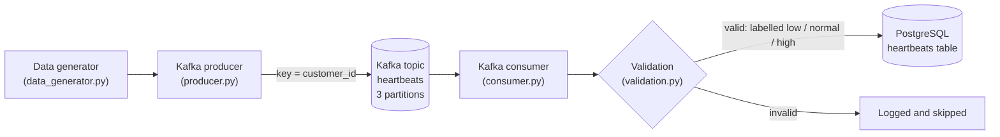
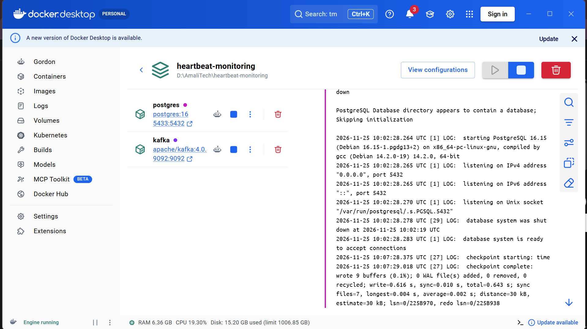
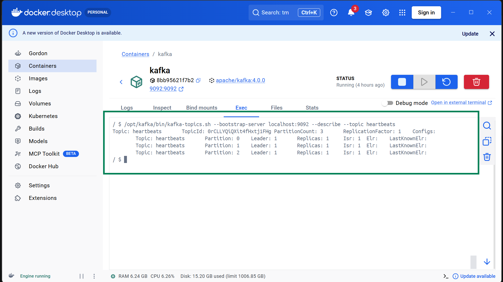
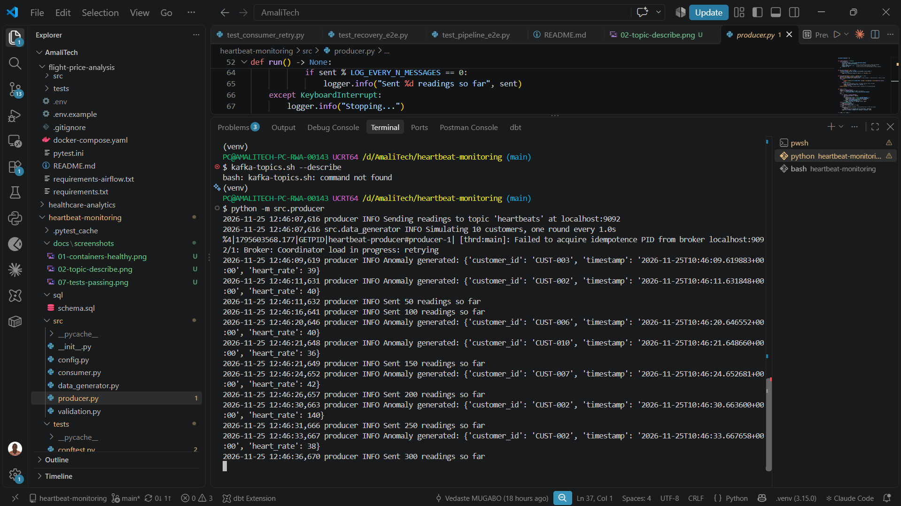
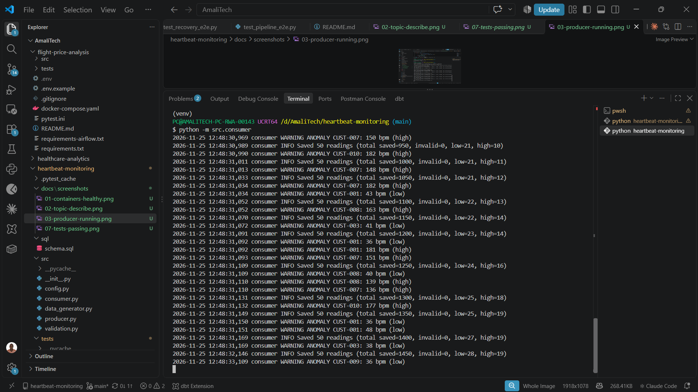
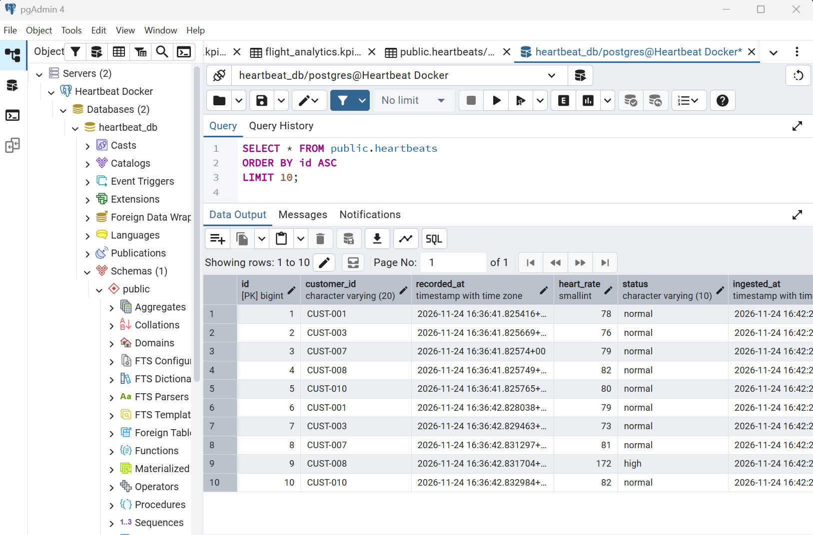
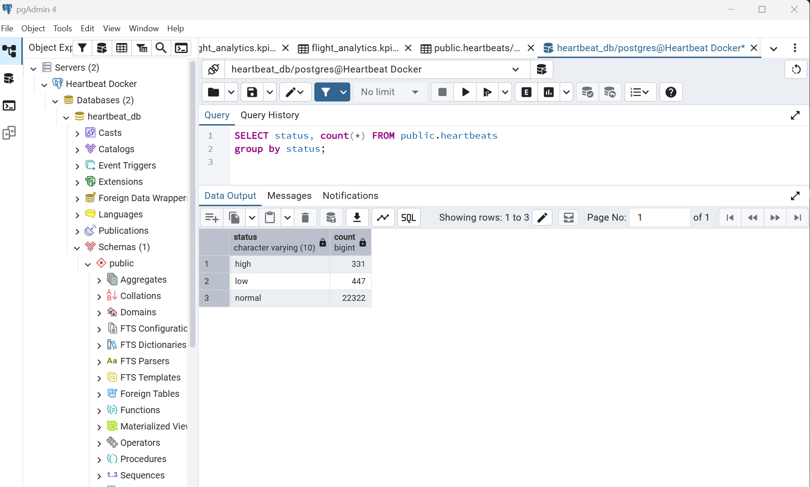
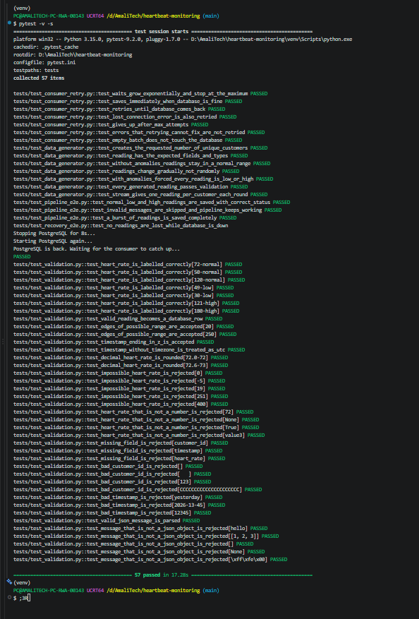
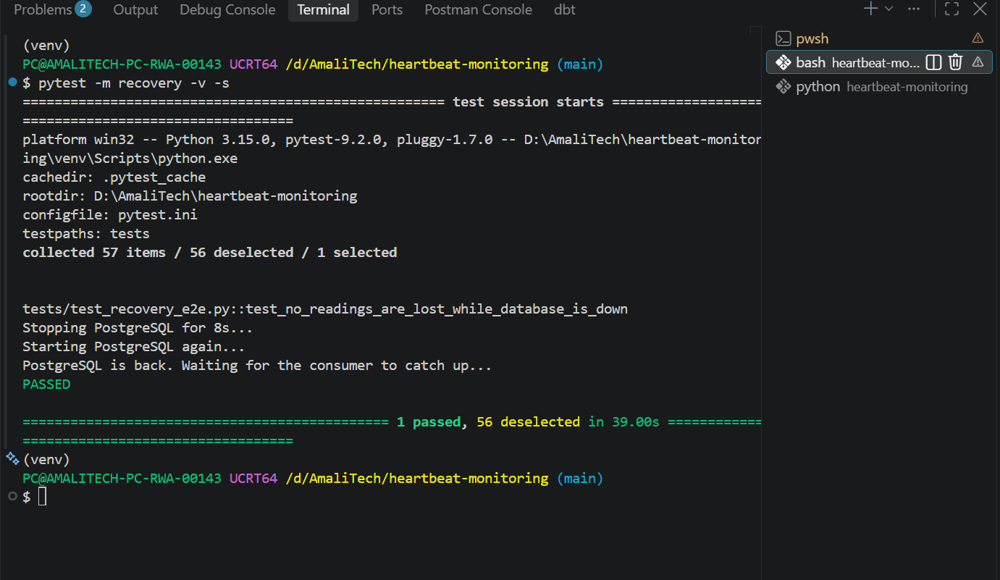

# Real-Time Customer Heart Beat Monitoring System

A data pipeline that simulates heart rate monitors for multiple customers, streams the readings through **Apache Kafka**, validates them in real time, and stores them in **PostgreSQL** for querying and analysis.

Abnormal readings (too low or too high) are detected and labelled as they arrive, and the pipeline keeps working through bad messages and database outages without losing data.

---

## Architecture



| Component | What it does |
|---|---|
| **Data generator** | Creates realistic heart rate readings for N fake customers. Each customer has a personal resting rate; readings drift gradually, with occasional spikes and drops (~3%). |
| **Kafka producer** | Sends each reading to the `heartbeats` topic, using `customer_id` as the message key so each customer's readings stay in order. |
| **Kafka** | Stores the stream of readings durably. Producer and consumer never talk directly, so either can stop without data loss. |
| **Kafka consumer** | Reads readings, validates them, saves valid ones to PostgreSQL in batches, then commits its Kafka offset. |
| **PostgreSQL** | Long-term storage, indexed for time-range, per-customer and anomaly queries. |

Each reading looks like this:

```json
{"customer_id": "CUST-007", "timestamp": "2026-11-24T09:15:02+00:00", "heart_rate": 78}
```

---

## Tech stack

- **Python 3.10+** with `confluent-kafka`, `psycopg2-binary`, `python-dotenv`, `pytest`
- **Apache Kafka 4.0** in KRaft mode (no Zookeeper), via Docker
- **PostgreSQL 16**, via Docker
- **Docker Compose** to run the infrastructure

---

## Project structure

```
heartbeat-monitoring/
├── docker-compose.yml      # Kafka + PostgreSQL
├── .env.example            # settings template (copy to .env)
├── requirements.txt
├── pytest.ini
├── sql/
│   └── schema.sql          # table + indexes, applied automatically on first start
├── src/
│   ├── config.py           # loads settings from .env
│   ├── data_generator.py   # synthetic heart rate readings
│   ├── producer.py         # sends readings to Kafka
│   ├── validation.py       # validation rules and low/normal/high labelling
│   └── consumer.py         # reads from Kafka, validates, writes to PostgreSQL
└── tests/
    ├── conftest.py               # shared fixtures for end-to-end tests
    ├── helpers.py                # shared test helpers
    ├── test_validation.py        # unit tests: validation rules
    ├── test_data_generator.py    # unit tests: generated data
    ├── test_consumer_retry.py    # unit tests: database retry logic
    ├── test_pipeline_e2e.py      # end-to-end: Kafka -> PostgreSQL
    └── test_recovery_e2e.py      # end-to-end: survives a database outage
```

---

## Setup

### Prerequisites

- [Docker Desktop](https://www.docker.com/products/docker-desktop/) (on Windows, enable WSL2 when asked)
- Python 3.10 or newer
- Git

### 1. Clone the repository

```bash
git clone https://github.com/MugaboVedaste/heartbeat-monitoring
cd heartbeat-monitoring
```

### 2. Create your `.env`

```bash
cp .env.example .env
```

Open `.env` and set `POSTGRES_PASSWORD`. Avoid the `$` character, or wrap the value in single quotes.

### 3. Start Kafka and PostgreSQL

```bash
docker compose up -d
docker compose ps
```

Wait until both containers show **healthy** (about 30 seconds). On first start, PostgreSQL automatically creates the `heartbeats` table from `sql/schema.sql`.

### 4. Create the Kafka topic

```bash
docker exec kafka /opt/kafka/bin/kafka-topics.sh \
  --bootstrap-server localhost:9092 \
  --create --topic heartbeats --partitions 3 --replication-factor 1
```

> **Git Bash on Windows:** write `//opt/kafka/...` instead of `/opt/kafka/...` (see [Troubleshooting](#troubleshooting)).

Check it:

```bash
docker exec kafka /opt/kafka/bin/kafka-topics.sh --bootstrap-server localhost:9092 --describe --topic heartbeats
```

### 5. Set up Python

```bash
python -m venv venv
source venv/Scripts/activate      # Windows (Git Bash)
# source venv/bin/activate        # macOS / Linux
pip install -r requirements.txt
```

Your prompt should now start with `(venv)`. Activate the venv in **every** new terminal you use for this project.

---

## Running the pipeline

Use two terminals, both in the project folder with the venv active.

**Terminal 1 – consumer** (start first):

```bash
python -m src.consumer
```

**Terminal 2 – producer:**

```bash
python -m src.producer
```

The producer logs progress every 50 readings and every anomaly it generates. The consumer logs each saved batch, skipped invalid messages, and `ANOMALY` warnings. Stop either with `Ctrl+C`.

Always use `python -m src.<name>` (not `python src/<name>.py`) so the `src` imports resolve.

To preview generated data without Kafka: `python -m src.data_generator`

---

## Checking the data

### With psql

```bash
docker exec -it postgres psql -U postgres -d heartbeat_db
```

Useful queries:

```sql
-- How many readings have been saved?
SELECT COUNT(*) FROM heartbeats;

-- Latest readings
SELECT * FROM heartbeats ORDER BY recorded_at DESC LIMIT 10;

-- Anomaly breakdown
SELECT status, COUNT(*) FROM heartbeats GROUP BY status;

-- Average heart rate per customer
SELECT customer_id, ROUND(AVG(heart_rate)) AS avg_bpm, COUNT(*) AS readings
FROM heartbeats GROUP BY customer_id ORDER BY customer_id;

-- Average pipeline delay (sensor reading -> saved in database)
SELECT ROUND(AVG(EXTRACT(EPOCH FROM ingested_at - recorded_at))::numeric, 3) AS avg_delay_seconds
FROM heartbeats;
```

Exit with `\q`.

### With pgAdmin

Register a new server with **Host** `localhost`, **Port** `5433`, **Database** `heartbeat_db`, **Username** `postgres`, and the password from your `.env`. The table is under *Databases → heartbeat_db → Schemas → public → Tables → heartbeats*.

### Kafka consumer lag

```bash
docker exec kafka /opt/kafka/bin/kafka-consumer-groups.sh \
  --bootstrap-server localhost:9092 --describe --group heartbeat-db-writer
```

`LAG` near 0 means the consumer is keeping up.

---

## How it works

### Database schema

| Column | Type | Meaning |
|---|---|---|
| `id` | BIGSERIAL | Primary key |
| `customer_id` | VARCHAR(20) | e.g. `CUST-007` |
| `recorded_at` | TIMESTAMPTZ | When the sensor took the reading |
| `heart_rate` | SMALLINT | Beats per minute; `CHECK` 20–250 |
| `status` | VARCHAR(10) | `low`, `normal` or `high`; `CHECK` enforced |
| `ingested_at` | TIMESTAMPTZ | When the pipeline saved it (default `NOW()`) |

Indexes: `recorded_at` (time-range queries), `(customer_id, recorded_at)` (per-customer history), and a partial index on `(status, recorded_at)` for non-normal readings (fast anomaly queries).

### Validation rules

A message is **rejected** (logged and skipped) if it is not a JSON object, is missing `customer_id`, `timestamp` or `heart_rate`, has a non-numeric heart rate, a heart rate outside 20–250 bpm, an empty or over-long customer id, or an unparseable timestamp.

Valid readings are **labelled**:

| Heart rate | Status |
|---|---|
| below 50 bpm | `low` |
| 50–120 bpm | `normal` |
| above 120 bpm | `high` |

Thresholds live in `src/config.py`. Anomalies are stored (not discarded), since they are what a monitoring system cares about most.

### Reliability

- **Ordering:** `customer_id` is the Kafka message key, so all readings from one customer go to the same partition and are processed in order.
- **Safe writes to Kafka:** the producer uses `acks=all` and idempotence, so retried sends never create duplicates.
- **No data loss in the consumer:** auto-commit is off. The consumer saves a batch to PostgreSQL **first** and only then commits its Kafka offset. If it crashes in between, Kafka re-delivers the unsaved readings on restart.
- **Database outages:** if PostgreSQL is unreachable, the consumer retries with exponential backoff (1s, 2s, 4s … up to 30s), reconnecting each time. While waiting it pauses Kafka consumption but keeps polling, so it stays in its consumer group. Readings wait safely in Kafka until the database returns.
- **Bad messages** are skipped individually and never stop the pipeline.

---

## Testing

| Command | What runs | Needs |
|---|---|---|
| `pytest -m "not integration and not recovery" -v` | Unit tests (validation, generator, retry logic) | Nothing |
| `pytest -m integration -v` | End-to-end: readings flow from Kafka to PostgreSQL with correct status; invalid messages skipped; 200-reading burst fully saved | Docker + consumer running |
| `pytest -m recovery -v -s` | Stops PostgreSQL, sends readings, restarts it, checks none were lost | Docker + consumer running |
| `pytest -v -s` | Everything | Docker + consumer running |

End-to-end tests use unique customer ids like `TEST-3fa9c1d2` and delete their rows afterwards, so they don't affect real data. They are skipped automatically if Kafka or PostgreSQL isn't running.

Current result: **57 tests passing.**

---

## Configuration

All settings are read from `.env` by `src/config.py`.

| Variable | Default | Description |
|---|---|---|
| `KAFKA_BOOTSTRAP_SERVERS` | `localhost:9092` | Kafka address |
| `KAFKA_TOPIC` | `heartbeats` | Topic name |
| `POSTGRES_HOST` / `POSTGRES_PORT` | `localhost` / `5433` | Database address (Docker maps 5433 → 5432) |
| `POSTGRES_DB` / `POSTGRES_USER` / `POSTGRES_PASSWORD` | — | Database login |
| `NUM_CUSTOMERS` | `10` | Simulated customers |
| `SEND_INTERVAL_SECONDS` | `1.0` | Seconds between rounds of readings |
| `ANOMALY_PROBABILITY` | `0.03` | Chance that a reading is a spike or drop |

---

## Troubleshooting

**`OCI runtime exec failed ... C:/Program Files/Git/opt/kafka/...`**
Git Bash converts Linux paths into Windows paths. Use `//opt/kafka/...`, prefix the command with `MSYS_NO_PATHCONV=1`, or run it in PowerShell.

**`database "heartbeat_db" does not exist` from Python, but psql inside Docker works**
Another PostgreSQL (installed on Windows) is using port 5432 and answered first. This project maps Docker's PostgreSQL to **5433**; make sure `.env` has `POSTGRES_PORT=5433`. Check what Python sees with:
`python -c "from src import config; print(config.POSTGRES_PORT)"`

**`role "..." does not exist`**
PostgreSQL creates its user from `.env` only on the very first start. Connect with the user that's in `.env`, or reset the database (deletes all data): `docker compose down -v && docker compose up -d`, then recreate the Kafka topic.

**Changes to `sql/schema.sql` don't apply**
Same reason: the schema runs only on first start. Reset with `docker compose down -v`.

**`ModuleNotFoundError: No module named ...`**
The venv isn't active. Run `source venv/Scripts/activate` and check for `(venv)` in the prompt.

**Topic is gone after `docker compose down`**
Kafka has no Docker volume in this setup, so its data is removed with the container. Recreate the topic (setup step 4).

---

## Limitations and future improvements

- **At-least-once delivery:** if the consumer crashes after saving a batch but before committing the offset, those readings are saved twice on restart. A unique constraint on `(customer_id, recorded_at)` with `ON CONFLICT DO NOTHING` would make writes idempotent.
- **Dead-letter topic:** invalid messages are only logged; sending them to a separate Kafka topic would let them be inspected or replayed.
- **Single broker:** fine for development. Production would use 3+ brokers with replication factor 3.
- **Kafka data is not persisted** across `docker compose down`.
- **Dashboard:** Grafana connected to PostgreSQL for live per-customer charts and anomaly panels.

---

## Screenshots

### Containers running


### Kafka topic with 3 partitions


### Producer sending readings


### Consumer validating and saving readings


### Readings saved in PostgreSQL


### Anomaly breakdown


### All tests passing


### Recovering from a database outage
